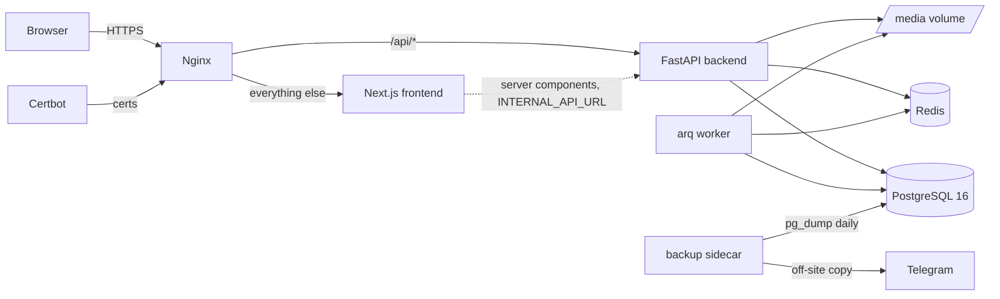

# Architecture

## Runtime pieces

- **nginx** terminates TLS (prod), sets HSTS and CSP, routes `/api/` to the backend and the rest to Next.js.
- **backend** is stateless FastAPI. Postgres holds all data and search indexes; Redis holds rate-limit counters and the arq queue. Uploads go through a storage interface onto a local volume (ADR 0005).
- **worker** runs arq jobs: emails, link checks, previews, digests, retention cleanup.
- **frontend** is server-component-first. The browser keeps a short-lived access token in memory; a httpOnly cookie holds the refresh token (ADR 0002).
- **backup** dumps Postgres daily and sends an off-site copy.

## Contract

FastAPI generates the OpenAPI schema; `make typegen` writes `frontend/openapi.json` and `frontend/src/lib/api/schema.d.ts`. CI fails when either is stale.

## Data

One `content_items` base table with joined-table subtypes (ADR 0001), `VARCHAR` + CHECK enums (ADR 0003), Postgres full-text and `pg_trgm` search (ADR 0004). Every error uses the `{code, message, fields?, request_id}` envelope; every list is cursor-paginated.
